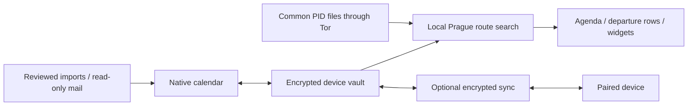

# Architecture

Calendula shares Flutter models/UI between Android and Windows with native
platform integrations for protected storage, widgets, background jobs, OAuth and
embedded Tor. It has no hosted Calendula calendar backend.

Events retain source identity, time, address, venue, room/floor and explicit class
type. Known room enrichment is bounded; ambiguous information requires review.
Routing reads shared public indices and applies fresh public predictions locally.
Weighted endpoint walks are accounted for once; some walking edges are estimates.

Causal sync uses immutable operations, tombstones and field conflicts. UI and
headless writers coordinate through transaction locks and reload before writes.
Widget results carry revision/fingerprint/freshness guards. Device credentials
remain separate from ordinary calendar packets. Explicit connection export is a
different encrypted operation with reviewed setup contents.

Android uses periodic WorkManager jobs and an optional bounded active service.
Windows supports a tray process and separate desktop agenda. OS scheduling,
account onboarding and real-network checks have distinct verification gates.
